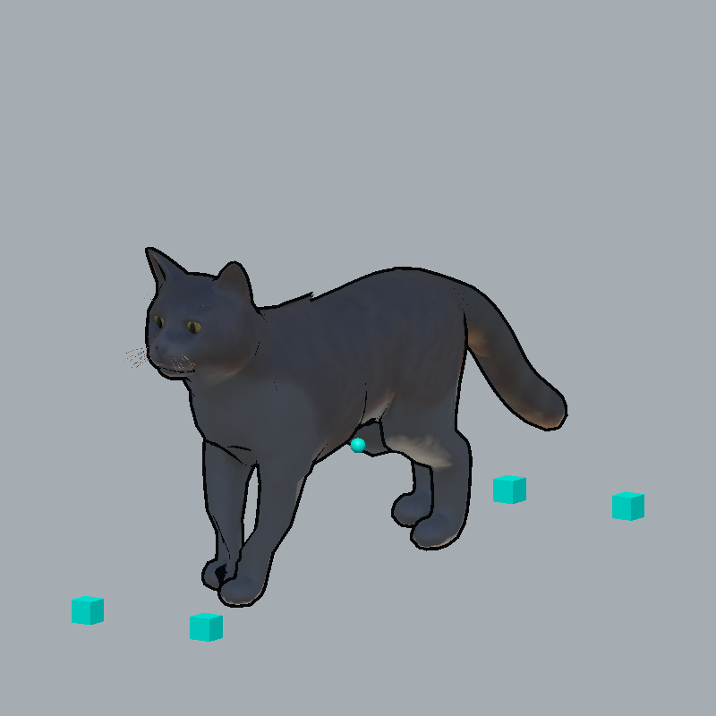

# HCI 宠物：猫步态接地转场修正

旧猫步态在支撑/摆动交界使用不同的前后速度，接地时存在速度突变。本次接受此前隔离的 v2 候选：前后运动改用匹配支撑速度与零接触加速度的五次 Hermite 轨迹，抬脚采用 sin³ 曲线，保留两秒四拍原地步态。FBX 仍是 97 个烘焙姿态键，不将数学轨迹连续性等同于导入动画处处连续二阶可导。

## 原资产和 HCI 行为

Blender 对新旧 FBX 的三组网格、5351 顶点、三角面索引、UV、蒙皮权重、40 骨骼层级/静止矩阵及材质名称对比均一致，最大比较误差为零。模型和贴图仍为原 Bicolor Cat，由 kenchoo 基于 guillaume bolis 的 Fripouille 制作，沿用项目中 CC BY 4.0 署名和来源记录。没有放大眼睛、重新建模或替换毛色。生成与审核脚本、轨迹单元检查一并保存。

这只修改既有猫原地行走预览，跟踪/标定根节点不随步态移动；实体目标不因此获得虚拟行走指令。HCI A 漫画描边、B 梦境、C 戳破、D 好感保持独立，继续共用火机同一套 YOLO→定位/选中→手势→对象魔法。嗅闻仍仅为嗅闻，不将其称为完整进食或睡眠动画，也不把步态修正算作全部宠物用例完成。

## 验证

Unity 6000.0.33f1 导入后，在 0.35m 尺寸及 37° 朝向下检查 193 个蒙皮姿态，最大支撑高度误差约 0.155mm，循环接缝为零，四脚抬升约 19.17mm。保存 ParkPet 的真实 Animator/按钮流程包含启停、转场、喂食打断至嗅闻、追踪丢失、撤销、复位、切换猫狗及实体/Live 保护；99 个 Animator 接地样本未测得地面穿透。几何与运行时证据各有明确范围，不是实拍动物的自然步态评估。

猫狗的 A/B/C/D 合成生产手势、描边蒙皮跟随和同帧像素检查通过，梦境独立性回归通过；另有 24 条共用手势、96 次条件动作回归。实际当前场景截图如下，沿用场景光照仍较暗，毛色/描边与照明需继续完善：

manifest 绑定源文件、完整源树、FBX、报告和日志 SHA256；主工作区暂存区未改变。各重任务串行，复用 Library，继续执行 RAM 启动 6 GiB/运行下限 3 GiB、Editor RSS 3.5 GiB、C/D 盘 20/25 GiB、单任务增长 1 GiB、日志 16 MiB、15 分钟守卫。五秒采样不是连续峰值。没有训练或下载模型。

本轮先交付通过编辑器检查的源码与资产，尚未编入旧打人柳 APK；后续 Android 结果单独记录。PICO 未连接，真实 YOLO、手部、双眼/遮挡及性能未验收；最终美术、其他八用例效果和模型任务继续 active。
