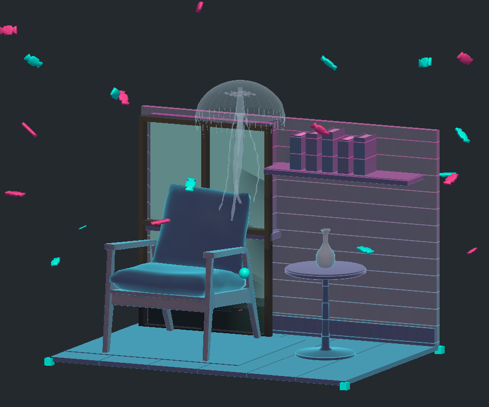

# HCI 出租屋四维魔法映射与组合播放

依据仓库 `pico-hci-yolo-vfx` 分支的 `HciMeetingScenarioNames.Hint(Bedroom)`，出租屋应当是 A 水彩/赛博、B 落地窗、C 水母灯、D 糖果雨。本批修正之前“A 选水母/糖果，B 召唤”的偏差，沿用火机共用识别器，不新增房间专用手势。

## 实现

| 维度 | 共用手势 | 房间行为 |
|---|---|---|
| A | 捏合后松开 | 水彩晕染 / 赛博描边与线条切换；Undo/Reset 恢复原材质 |
| B | 指尖画圈 | 从底部展开虚拟落地窗，保留家具位置 |
| C | 张掌横挥 | 打开已有的浮动水母灯，重复 C 不关闭糖果雨 |
| D | 握拳后张开 | 在已确认天花板下持续降下糖果，不再要求先用 A 选择糖果 |

四种状态独立保存；A 不清除 B/C/D，D 不再关闭 C。移除 B 对 D 实验维度的错误依赖，仍由公共实验条件控制各维度是否允许。实际入口保持 YOLO 家具识别 → 手动空间确认与可靠定位/选择 → 火机共用手部采样与识别 → 对象效果。

房间风格仅作用于虚拟房间的既有几何和贴图。新着色器提供物体坐标下的低频颜料变化、粉彩色调，及赛博轮廓/水平线条；不修改摄像头透视图像。落地窗包含边框、竖梃、横档与简化的背景色块，属于虚拟房间中的装饰窗景，并非真实墙面开洞、可穿越传送门或房间重建。美术细节仍需继续完善。

窗体使用 Unity 内置共享立方体网格；窗口缩放动画不移动追踪根节点和家具。水母复用已有资源；糖果继续使用固定 32 槽池中的 24 个粒子。材质按原共享材质缓存，只在初始化创建，销毁时释放；没有逐帧写文件、下载或模型训练。

## 验证与证据

- `HciRoomMagicChecks.Run` 在已保存 ParkRoom 场景进入 Play Mode。合成关节采样经过生产 `ProcessHandSample`，逐条与火机 `TabletopGestureRules` 比较，检查一次识别/一次施法。覆盖 A 两种风格、B 展开中与完成态、C 水母、D 无天花板拒绝/确认后接受、四效果共存、重复 C 保留 D、Undo D/B、Stop、目标丢失/恢复与 Reset。
- 检查施法期间家具世界矩阵和追踪根不变、材质数量/粒子池不增长、Reset 恢复原共享材质。目标丢失及完整 Reset 清除尺寸标定是既有设计，不把重新标定前后的模型尺寸差异误当作动画移动实物。
- `NaturalRoomPlayChecks.Run` 同步改用 C 水母、D 糖果，保留淡入/脉动/停止淡出、撤销、重启、24 粒子持续超过三秒、天花板移动后跟随、复位/丢失/恢复/退出及音频清理检查。A 不再用作清除效果，显式 Stop 负责停止。
- 共用手势及实验条件回归结果见本目录独立 result 文件；合成 CSV 不属于真实被试数据。资源记录为每五秒采样，不是连续峰值。
- 九张 `room-*.png` 为实际 Play Mode 相机渲染，包括原始、水彩、赛博、窗口展开、组合糖果与复位；另附原水母/糖果生命周期渲染。青色标记为测试定位辅助，黑灰背景为审查背景。

首轮组合检查发现 D 沿用通用奖励逻辑清除了水母状态，已修正；另一轮检查错误地要求追踪丢失后仍保留尺寸标定，已修正该测试假设。旧失败日志留在本地，不计入通过证据。后续画面检查降低了过于规则的水彩颗粒频率；最终结果以本目录通过记录为准。

## 尚未验收

本批是虚拟房间模型与合成手势的编辑器交付，没有生成新 APK。真实家具 YOLO、三维定位、房间空间几何/遮挡、PICO 双眼渲染与帧率仍需接入实际设备验证，不能以这些通过记录替代。现有 `hci-unified-validation-20261116` APK 不包含本批房间映射以及近期石像/宠物增量。

保持单 Unity、单 Job Worker/BEE 线程；可用内存 3 GiB、C 盘 20 GiB、D 盘 25 GiB、日志 16 MiB、磁盘增长 1 GiB 和 15 分钟守卫。复用已有 Library；未重启、未开启训练。全部八用例和 32 效果的 Goal 继续 active。

