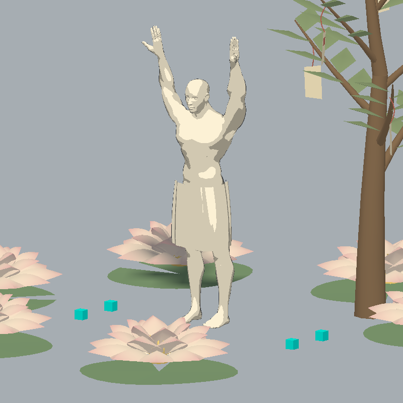

# HCI 人形石像 B：完整伸展与共用手势接入

本批把上一批全身资源候选接入保存的 ParkStatue 场景。默认人形石像由半身像改为全身雕塑，B 不再仅展示扫描环和第一段故事，而是播放约 5.067 秒的完整伸展，随后回到初始姿态。青铜兽继续使用原有模型；其全身动作没有被这次人形动画替代，仍待补齐。

## 交互与模型

- 继续使用 YOLO 目标 → 定位/选择 → 火机共用 `TabletopHandSample` / `TabletopGestureRules` → A/B/C/D 对象效果。没有修改共用手势阈值或引入石像专用识别器。
- 人形 B 使用手动驱动的 Unity PlayableGraph；演员协程拥有动作时钟和取消权。整个动作完成前保持 Busy，防止下一次魔法打断状态。骨架动画不施加根运动，不改变实物定位或手动标定。
- A 卡通外观和 D 荷花许愿树在 B 前后保留。C 继续使用已有的明确标注为虚构的故事/来源，不将这个虚构雕塑包装成真实历史文物。
- Stop、Reset、Undo、追踪丢失及退出时恢复初态。禁用/销毁释放动画图，恢复追踪后的下一次 B 重新建立动画图。
- 源自 Quaternius CC0 成人基础模型，改编披布、石材和完整动画。12,950 三角形，名义静止高度 0.48 m，验证时标定为 0.4 m。原半身像资产仍保留。来源和许可证见 `Assets/ThirdParty/NaturalDecor/StandingStatue/`；美术比例和材质仍可进一步优化。

## 验证

- `HciStatuePlaybackChecks.Run`：打开保存的 ParkStatue，进入 Play Mode，由合成关节采样经过生产手势入口，与火机识别器逐条比对 A/B/D，每次仅触发一次。观察实际动画图逐帧播放、抬臂、回位；检查脚和骨盆漂移、实物根节点/标定不变、几何三角形与关闭根运动。
- 检查 B 不覆盖 A/D、Undo 保留先前效果、中途 Stop、Reset、追踪丢失、恢复追踪后再次施法、切换青铜变体时清理旧角色。六张图片来自 Play Mode 实际相机渲染，未替换成 CPU 姿态快照。
- 共用手势回归覆盖六个 Park 内容入口的 24 条手势；卡通外观回归覆盖人形/青铜的 A/B/C；荷花许愿树回归覆盖两变体 A/D、停止/撤销/复位/定位失效；实验条件矩阵覆盖 96 次尝试和 139 条记录。独立结果、轨迹与资源采样附于本目录。
- 等待逻辑从固定短延迟调整为等待演员不再 Busy，保留超时守卫，避免新增长动作尚未结束就发送下一手势。中断测试仍在动作进行中发起，未改为只在闲置时停止。
- 初次装配遇到导入器单位缩放和无 Animator 的问题，已显式设置文件单位并添加 Animator。首轮中断检查过早超时，已按实际播放进度触发。发布只使用修正后的通过结果，早期失败不计入验收。

本报告中的关节、目标与确认平面均为合成测试输入，CSV 不是被试数据。通过不代表真实 YOLO→三维定位→PICO 手势的端到端通过，也不代表遮挡、双眼渲染或移动端帧率达标。

## 资源与交付边界

使用现有 FBX，不再下载基础包，不训练新模型。单 Unity 进程、单 Job Worker，保留可用 RAM 3 GiB/C 盘 20 GiB 下限和日志/磁盘增长/时间守卫；各次结果为间隔采样，不冒充连续峰值。保留 Library，不重启电脑。

本批发布源文件与编辑器证据，没有新 APK。现有 `hci-unified-validation-20261116` 发布包不包含本次人形伸展。后续继续青铜动作、C 历史/语音、其他用例差异、YOLO 权重和真实 PICO 联调；Goal 保持 active。

