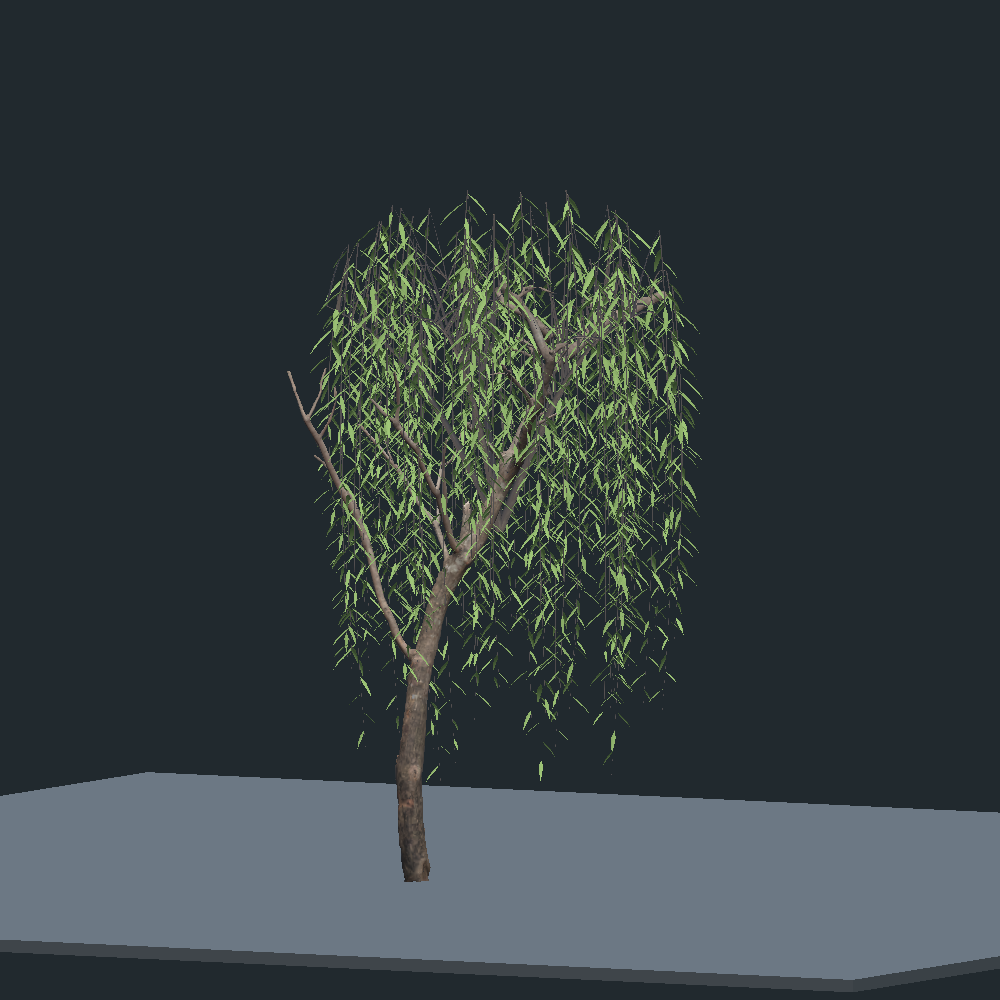
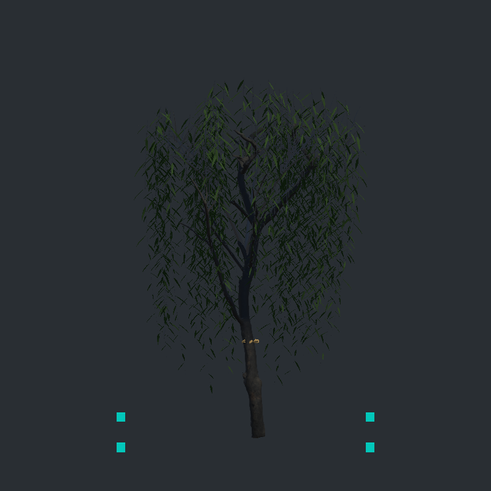

# HCI 打人柳冠层模型与动画验证

打人柳此前与四季树共用普通小树冠层。本次增加 100 条垂枝、2400 片窄折柳叶，复用已有树干和五组枝条骨骼，接回现有 A 深色切换、B 抽打、C 树疤呼吸、D 封印开箱。四季树保留原网格、叶片贴图和四季效果。内容选择不替代 YOLO、定位或施法，仍使用火机共用 A 捏合松开、B 指尖画圈、C 张掌横挥、D 握拳张开。

## 实际画面

下面是 Unity 的真实渲染；Play Mode 输入为合成关节轨迹，不是 PICO 录像。

## 实现与来源

新增的柳叶、细枝和主支撑枝由 WillowCanopyAssetBuilder 确定性生成，种子 4747；柳叶为弯曲折面网格，包含颜色差异和整片叶片标识。柳叶 19200 顶点/19200 三角形，枝条 11955 顶点/21840 三角形，均为 16 位索引，每顶点最多两组骨骼权重。未使用图片卡片代替模型，没有新贴图、模型下载或训练。

树干、原始材质和骨架来自项目已保存的 Poly Haven tree_small_02（Rico Cilliers，CC0-1.0）。原始来源、许可、转换记录继续保存在 Assets/ThirdParty/NaturalTrees/SmallTree。新冠层为本项目原创几何，并非该来源提供的柳树扫描，也不声称达到植物学物种重建精度。

导入 FBX 的蒙皮渲染器带轴向/缩放帧，直接换新网格会导致冠层显示位置错误。新冠层改为 TreeGrowth 度量坐标系中的两个规范化蒙皮渲染器，绑定既有骨骼。原冠层与柳树冠层分别缓存，切换时只改变可见性，主体同时活动三项、缓存五项；不复制网格或材质。叶片 shader 的新顶点色参数默认关闭，原四季树材质保留既有行为。

## 通过的检查

- 几何、权重、法线和切线有限；实际 BakeMesh 检查中 19200/19200 柳叶顶点发生变形，抽打保持树干/现实根节点和尺寸拟合不变，异常风输入恢复静止蒙皮。
- 12 次体验切换保持原始及新增资产身份，不产生网格/材质副本。完整 Reset 按既有语义清除尺寸/朝向标定，保留体验选择；禁用/重新启用不损坏冠层。
- 原树季节、成长、撤销和蒙皮检查通过。保存 ParkTree 的两种体验分别执行虚拟流程及合成 Observe 的实体目标代码分支完整流程；每次动作由生产 ProcessHandSample 与火机规则逐采样比对。
- 共用手势 24 条轨迹、四实验条件下 96 次动作回归通过。合成实体夹具隔离硬件接收器，CSV 身份和事件明确标注 SYNTHETIC，不充当受试者或真机实验。
- 正反面、深色冠层及 Play Mode 抽打、树疤、宝箱画面实际检查。工作室静态检查只以 BakeMesh 证明抽打几何变形，未将未更新 GPU 蒙皮的编辑模式截图当作动画证据。

manifest.json 绑定所有变更源文件、完整项目源树、Unity 日志哈希、资源守卫与检查结果。初次错误绑定、临时 Mesh 生命周期、Reset 断言及 PowerShell 运行器问题的失败证据保留本地；最终结果不掩盖这些修正。

## 资源和未完成范围

各 Unity 重任务串行，复用暖 Library；启动前可用 RAM 至少 6 GiB，运行下限 3 GiB，Editor RSS 上限 3.5 GiB，C/D 盘最低余量 20/25 GiB，单任务增长上限 1 GiB、日志 16 MiB、15 分钟超时。遥测为五秒采样，不能解释为连续峰值。没有启动训练、大文件下载或重启；主工作区 Git 暂存区保持不变。

本次是编辑器源码增量，旧语音/扑翼 APK 不包含它。树干裸枝与柳冠衔接、暗色树冠可读性、宝箱美术仍需精修。Tree 合格 YOLO 权重、PICO 实物与手部输入、双眼/遮挡及性能未验收，不能把合成实体代码分支称为真实识别。全部八用例 32 项效果、训练/适用大模型接入、Android 增量及真机 Goal 保持 active。
