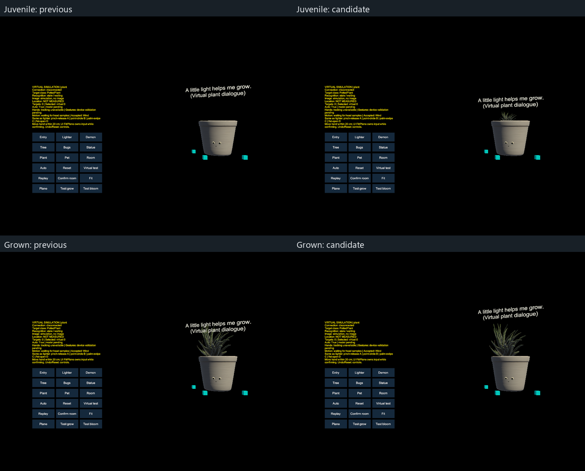
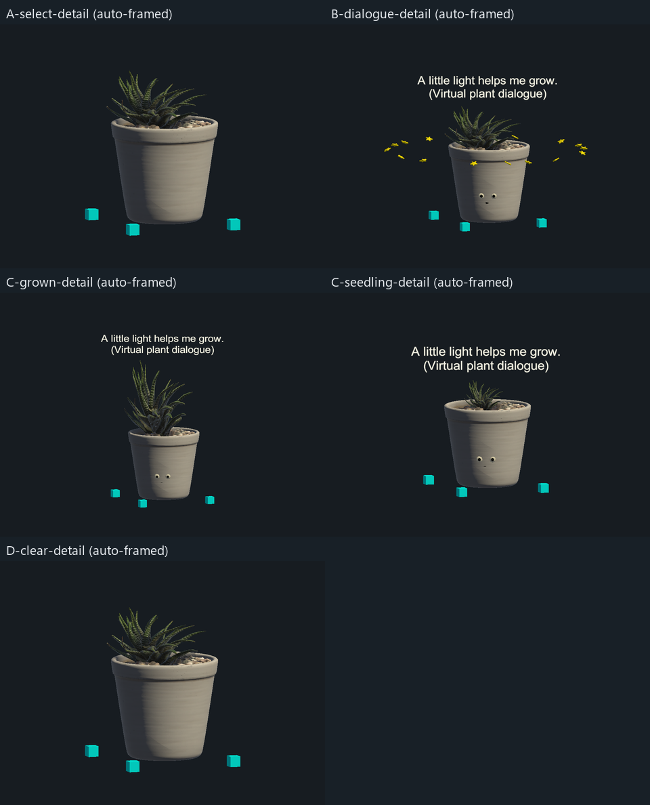

# 植物幼苗与字幕：源码候选交付（2026-11-20）

父版本 restore-4d-lighter@6f6df975c036f526bfb7d1f75654d0fa43d74c9d；开发基线仍 codex/mr-development-snapshot-20261109@8359a0c。仅修改植物专用 ParkActor.NaturalPlants.cs，使C幼苗保留可见叶簇并让B字幕跟随冠顶；保留原中性/长大轮廓，花盆、拟合和追踪锚点不动。共享ParkActor.cs、火机场景/模型/动画/效果/YOLO权重、生产手势、植物模型/贴图/meta和英文示范WAV未改。

旧流程四项源码、旧语音两项源码与当前不同，不能沿用旧pass。当前v1状态检查通过后实际查看画面，发现幼苗近乎藏盆内、长大叶片穿字幕；修复后按保存ParkPlant重查。合成A选择不误开花、B拟人文字/五个表情renderer、C生长/回幼苗、扩展开花、D清除、Undo、Reset、无效手/维度/追踪丢失门控与固定锚点通过。新增实际蒙皮冠顶/盆沿/字幕底边几何检查和细节相机。

实际取样：幼苗叶尖高出盆沿0.06799805m，长大0.247729659m；字幕与叶尖间距B约.02580m、长大.02365m、幼苗.02514m，盆矩阵不变。这些是合成拟合空间中的虚拟几何，不能当真实房间或设备测量。12张960x720原生图及3幅QA图实际查看；近景为独立自动取景，不能用其像素大小推断物理生长比。

语音继续复用约2.57秒单声道英文离线示范，字幕相同；PCM包络驱动嘴部。重播/结束闭嘴/Undo/D/追踪丢失恢复/暂停/Reset/禁用及单AudioSource检查通过。语音截图中的LIVE TCP是配置状态，连接仍断开，输入仍为合成维度调用；没有真实识别、物理手势或听到扬声器输出的证据。人物表情尺寸和字幕阅读仍需PICO确认。

回归：PowerShell 7 执行 Tools/run_room_magic_review_bounded.ps1 -ProjectRoot <已配置SDK的隔离工程绝对路径> -RunId <唯一名称> -Check PlantFlow；语音另用 -Check PlantVoice。两模式日志在 Reports/plant-effect-review-20261120/<RunId>，原图在候选 .codex-tmp/hci-plant-flow 或 hci-plant-voice。原RoomMagic/RoomWindowOwnership模式保留。拒绝覆盖已有结果、拒绝已有Unity，需6GiB空闲RAM/C盘20GiB/工程盘25GiB，单工作线程；拥有进程Job限制240秒/最低3GiB/RSS3584MiB/净盘增512MiB/图32MiB/日志8MiB。默认Unity D:/Unity/Hub/Editor/6000.0.33f1/Editor/Unity.exe。源码payload须匹配，截图需另行查看；采样不是连续峰值。

最终原生流程33.08秒（最低采样RAM7.358GiB/RSS1518.60MiB），语音29.91秒（7.819GiB/1612.43MiB）均退出0。中间Editor缺集合using编译失败、BakeMesh默认参数重复计入导入缩放产生31m错误，均保留失败输入；修正Editor引用、显式缩放补偿及合理尺寸检查后重跑。未放宽幼苗可见或字幕间距条件。

本地APK PlantPresentationValidation-20261120.apk，78064133B，SHA256 f3c8553d646f9871631dd023da4eafb45c3d3719cb4857965afaa1505f40fe31。15场景、签名CRC/资源/16 ARM64 ELF/zipalign/min29target35及三个新植物字段IL2CPP metadata通过；最低采样RAM3.45GiB/RSS5551MiB，编译并发1。BuildReport列主ParkActor.cs/WAV但不列该分部源文件，因此按输入源码SHA和实际链接字段核对，未为此重建。SDK已知四XR预加载差异归档并精确恢复；旧包保持，新包未上传。

便携摘要 [Reports/plant-current-review-20261120/delivery-summary.json](Reports/plant-current-review-20261120/delivery-summary.json)；逐效果状态 [Reports/plant-current-review-20261120/delivery-case-status.json](Reports/plant-current-review-20261120/delivery-case-status.json)。两张QA图随本次显式清单发布，其哈希见摘要；其余原图/详细日志在本地保留。前序房间窗景/对象释放和非火机门禁摘要继续保留。SOURCE_VALIDATION的sourcePayloadTree为完整候选Git树去掉其自身；payloadFiles仅声明核对范围，其余继承内容不升级验收。独立索引/显式10项/JC4747-jc身份，不改主暂存/HEAD/traeye，不强推或四小时定时上传；实际远端状态由独立回执核对。

仍未完成：真实YOLO→HCI实际手势→效果、设备听感/可读性/双眼/性能、独立项目数据和非火机模型准确率、最终美术及完整8案例32效果。设备按用户安排暂不连接，每个植物效果行仍未完成。
