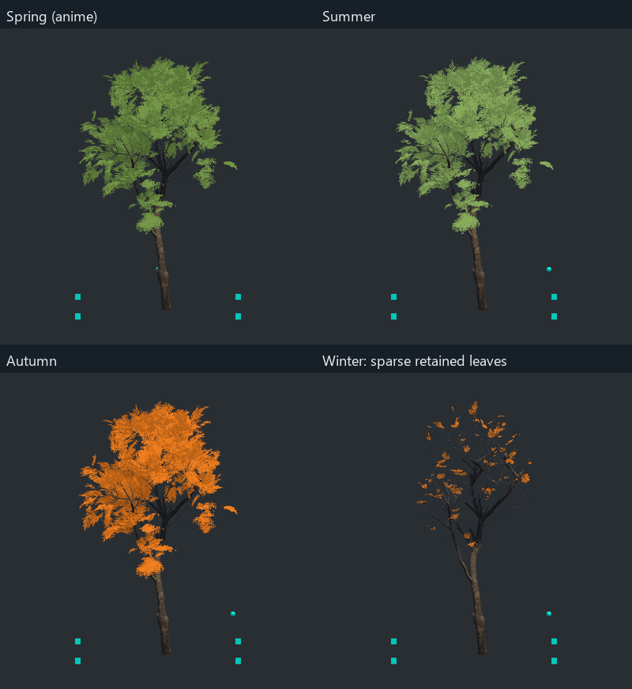
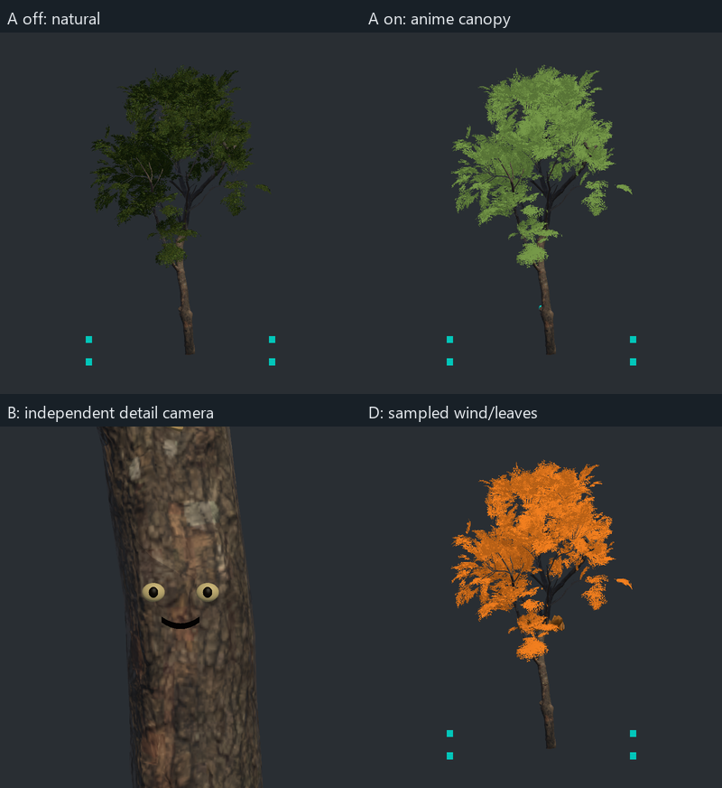
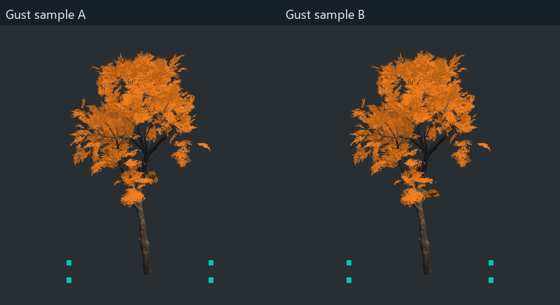

# 四季树当前场景与合成选择：检查候选交付（2026-11-20）

父版本 restore-4d-lighter@18f829b5215c2495e75b1b5ebad564cb26a56bd4，开发基线仍 codex/mr-development-snapshot-20261109@8359a0c。只改Editor HciSeasonTreeChecks和有界启动器，并附摘要、未完成状态与三幅已查看QA。生产代码/手势、树模型/材质/场景/骨骼/meta及火机不变。旧树种选择报告四源码中三项不同，不能沿用旧pass；打人柳树冠特定代码/几何未变的范围可复用，不外推整个打人柳交互。

当前保存ParkTree自然体验：A动漫冠层可逆且季节不变；B五renderer脸/实测眨眼；C夏秋冬春与覆盖脱落恢复；D有界枝条风和叶片，不误开幻想宝箱；Undo、拟合/锚点稳定、中断Reset通过。现有共享分类器接收合成关节样本，每样本与lighter分类器比较、每次恰好1事件。过时Editor 45拳超窗未执行，按原常量派生3拳，实际虚拟.124990463秒/选择模式.125秒，均落在未改.04–.55秒窗口。

21张800x800原生图（虚拟10、合成选择11）和五幅QA均实际查看。春夏绿色差异较轻；冬coverage .025保留少量整叶，叶冠ROI秋橙67137像素/冬5130像素；回春恢复。它们不是最终美术或头显可读性验收。脸部为独立近景相机；其眼高包络有实际眨眼记录。

约.236/.234秒两次取样，两模式5/5枝条改变局部旋转、24/24活动叶片改变位置，最大位移约.04419/.04397m，对象池固定32，随后枝条复位通过。仅证明取样间运动。虚拟检查41.42秒/55采样（最低RAM7.367GiB/RSS1833.24MiB），合成选择39.84秒/53采样（7.739GiB/1921.48MiB），退出0且资源守卫未触发；采样不是连续峰值。

RunLive只是历史测试方法名：检查在ParkTree中注入SYNTHETIC_OBSERVE_TREE的Observe坐标和关节样本，硬件接收器只在fixture内禁用，不是真相机/TCP/YOLO/PICO输入。验证生产真实目标模式的点选捏合、自然/幻想UI切换不换ID/位置/fit、幂等、虚拟专用Awaken/Replay拒绝、模拟物理混用/Busy/Fit/Plane/过期/外来实例/丢失/禁用/空/错场景门控，以及UI持捏/释放不施法。CSV20行subject全部为SYNTHETIC_OBSERVE_TREE_SEASON，包含synthetic_fixture事件；原StudyLogs保留，不当人类实验或识别准确率证据。

PowerShell 7：Tools/run_room_magic_review_bounded.ps1 -ProjectRoot <已配置SDK的隔离工程绝对路径> -RunId <唯一名称> -Check SeasonTree；合成选择用 -Check SeasonTreeSelection。原六模式保留。输出Reports/tree-effect-review-20261120/<RunId>，原图位于候选.codex-tmp/hci-season-tree或hci-live-season-tree。拒绝覆盖旧结果/已有Unity；需6GiB可用RAM、C盘20GiB/工程盘25GiB；默认Unity D:/Unity/Hub/Editor/6000.0.33f1/Editor/Unity.exe。单工作线程/拥有进程Job限制240秒、最低RAM3GiB、RSS3584MiB、净盘增512MiB、截图32MiB、日志8MiB。payload需精确匹配，PASS不替代看图。

1865项冻结输入只改Editor/工具两行，运行时/资产/Packages/ProjectSettings通过前序证明链与f3c8 Android输入相同，复用PlantPresentationValidation-20261120.apk 78064133B SHA256 f3c8553d646f9871631dd023da4eafb45c3d3719cb4857965afaa1505f40fe31 的15场景/签名CRC/资源/16 ARM64/zipalign/min29target35静态检查，未重建/上传APK。原有包、主HEAD/暂存和用户文件保留；不强推、不改traeye分支/历史，不进行四小时自动上传。

便携摘要 [Reports/season-tree-current-review-20261120/delivery-summary.json](Reports/season-tree-current-review-20261120/delivery-summary.json)；四效果仍未完成 [Reports/season-tree-current-review-20261120/delivery-case-status.json](Reports/season-tree-current-review-20261120/delivery-case-status.json)。三QA图哈希见摘要，其余原图/日志/合成CSV保留本地。SOURCE_VALIDATION的sourcePayloadTree为完整候选Git树去掉其自身；payloadFiles只是已核对范围，其余继承内容不新增验收。独立索引显式10项、JC4747-jc身份，实际远端结果由回执核对。

未完成：真实YOLO→HCI实际手势→效果、PICO/双眼/读距/长期性能、春夏区分及最终美术、独立实拍数据/非火机模型准确率和完整8案例32效果。设备按用户安排暂不连接。
