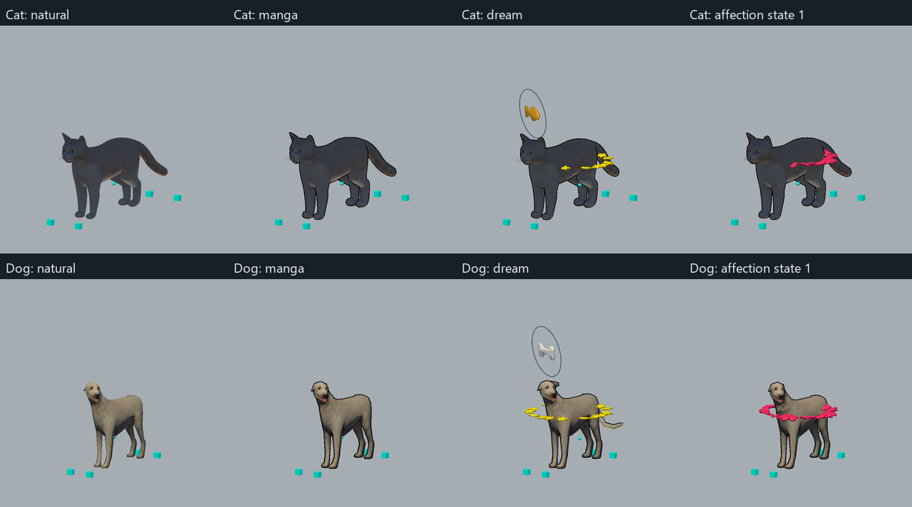
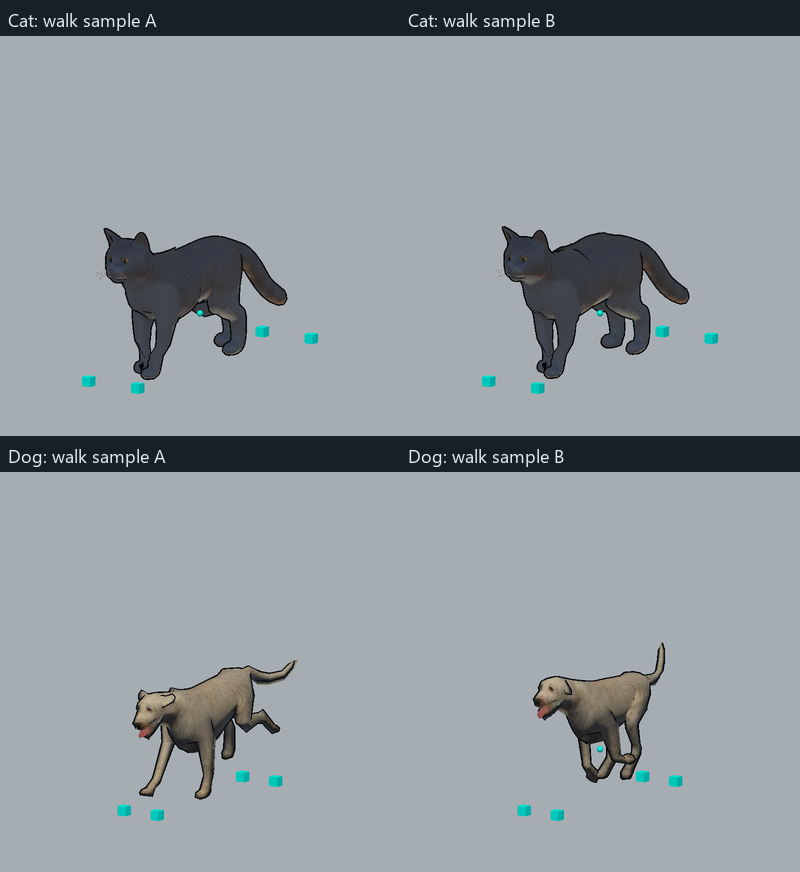

# 宠物当前场景回归与渲染：检查候选交付（2026-11-20）

父版本 restore-4d-lighter@f940e12023ffdc54e8ecbadcaf78f1686afb0dcc，开发基线仍 codex/mr-development-snapshot-20261109@8359a0c。本次只修改Editor HciPetOutlineChecks和有界检查启动器，并附范围摘要、状态表及两张已查看QA图。生产代码、手势、猫狗模型/场景/FBX/Animator/纹理/meta、火机全部保持。

旧梦境报告九项中五项、旧轮廓报告八项中两项源码/场景/资源与当前不同。按当前保存ParkPet重新检查Cat和Dog：A漫画轮廓、B梦境、C戳破、D好感+1保持独立；B幂等、空泡戳破拒绝、Undo、Stop/重开、Reset、丢失/远/无效输入门控、锚点与拟合稳定、共享导入网格/骨骼与绕序、同帧描边像素差异均通过。Dream使用合成动作调用；Outline使用实际共享分类器接收合成关节样本，对照原lighter分类器逐样本一致，各次恰好一个事件。不是实际手部或YOLO识别。

旧Editor D轨迹45次拳采样名义超过1.35秒，已知超出现有.04–.55秒窗口，未重跑已知失败输入；按原常量派生3拳，实际Cat .124986649秒/Dog .124938965秒，各1事件，生产规则未改。第一次近景把狗泡上缘裁掉；扩大固定QA取景并验证气泡投影边界保留.02视口裕量，原主相机不动。去掉过时的固定12图成功字符串，数量以实际文件和摘要为准。

最终22张实际图（主相机梦境6张800x600、独立复核相机16张800x800）及4幅QA总览已查看。同帧开/关描边阈值8改变Cat5291像素、Dog4264像素。Dream退出0，36.88秒/49采样，最低RAM7.389GiB/RSS1952.57MiB；最终Outline退出0，51.06秒/68采样，最低RAM7.466GiB/RSS1618.70MiB。采样不是连续峰值。

约.273秒/.269秒间隔的局部姿态取样，Cat17/50、Dog43/51变换移动，均覆盖四条腿链，排除了只靠全局追踪根移动的替代。只证明所取两次姿态中的导入动画运动；不证明完整周期、自然步态或脚部接地。狗图呈现奔跑/腾空感是视觉推断，未做接地类别测量，不能凭WalkSource名称标成自然走路通过。Cat FBX与旧步态v2资产SHA相同，也不将旧193姿态/原隔离差异升级为当前全部交互验收。Sniff不是吃饭/睡觉；后两项为可选扩展，不能抢占必需四效果。

PowerShell 7：Tools/run_room_magic_review_bounded.ps1 -ProjectRoot <已配置SDK的隔离工程绝对路径> -RunId <唯一名称> -Check PetDream 或 PetOutline。原RoomMagic、RoomWindowOwnership、PlantFlow、PlantVoice四模式保留。输出 Reports/pet-effect-review-20261120/<RunId>，原图在候选 .codex-tmp/hci-pet-dream 或 hci-pet-outline。拒绝覆盖旧结果/已有Unity；需6GiB可用RAM、C盘20GiB/工程盘25GiB；默认Unity D:/Unity/Hub/Editor/6000.0.33f1/Editor/Unity.exe。拥有进程Job单工作线程，限制240秒、最低RAM3GiB、RSS3584MiB、净盘增512MiB、图32MiB、日志8MiB。payload需精确匹配，PASS不替代查看图。

当前1865项冻结输入与原f3c8 Android输入相比，仅Editor和工具两行变化，其余1863项（包括运行时、资源、Packages、ProjectSettings）相同，因此复用 PlantPresentationValidation-20261120.apk 78064133B，SHA256 f3c8553d646f9871631dd023da4eafb45c3d3719cb4857965afaa1505f40fe31 的15场景签名CRC/资源/16 ARM64/zipalign/min29target35检查，未重建或上传APK。所有旧包、主索引/HEAD/用户暂存保留；不强推、不改traeye分支/历史，不进行四小时自动上传。

便携摘要 [Reports/pet-current-review-20261120/delivery-summary.json](Reports/pet-current-review-20261120/delivery-summary.json)；Cat/Dog八个变体效果行仍未完成，见 [Reports/pet-current-review-20261120/delivery-case-status.json](Reports/pet-current-review-20261120/delivery-case-status.json)。本次两图QA哈希在摘要中，其余原图与详细日志留本地。SOURCE_VALIDATION的sourcePayloadTree为完整候选Git树去掉其自身，payloadFiles仅为核对范围，其余继承内容不新增验收。独立索引显式9项，JC4747-jc身份，实际远端状态由单独回执确认。

未完成：真实YOLO→HCI实际手势→效果、PICO/双眼/可读性/性能、最终美术、完整动作自然性与接地、独立项目数据/非火机模型准确率及8案例32效果整体验收。设备按用户安排暂不连接。
